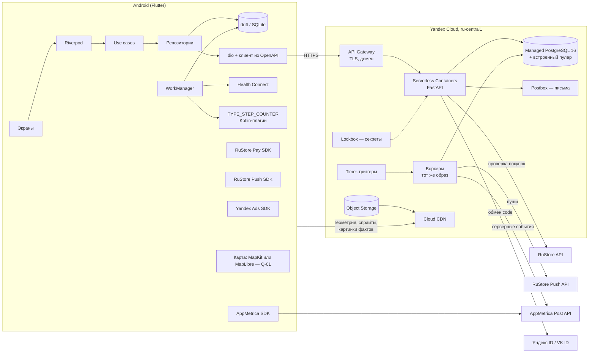
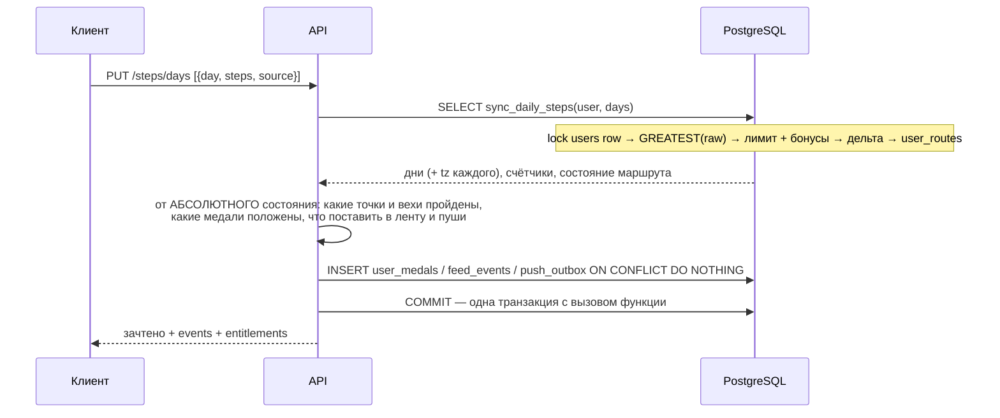

# Архитектура «Путника»

## 1. Компоненты



Ключевые свойства:

* **Сервер не знает, где пользователь.** Он получает только число шагов за локальный день. Координаты есть лишь у точек маршрутов (публичный контент).
* **Клиент работает офлайн.** Шаги копятся в drift и уходят батчами; маршрут, геометрия и факты кэшируются по `ETag` и `sha256`.
* **Контейнеры без состояния.** Всё состояние — в PostgreSQL и Object Storage, поэтому API масштабируется числом экземпляров.
* **Фоновая работа сервера — outbox-таблицы + таймеры.** Воркер раз в минуту забирает пачку через `FOR UPDATE SKIP LOCKED`. Брокер очередей не нужен до ~100 тыс. DAU.

## 2. Клиент: слои и модули

```
app/
  lib/
    main.dart, bootstrap.dart        — инициализация, ProviderScope, обработка ошибок
    core/
      config/      — AppConfig из --dart-define и /app/config; заглушки ключей с инструкцией
      network/     — dio, AuthInterceptor (refresh с одиночной блокировкой), ProblemDetails → Failure
      db/          — drift: local_days, outbox, кэш маршрутов
      l10n/        — app_ru.arb, app_en.arb, app_zh.arb (ICU, plural)
      router/      — go_router, guard'ы: онбординг → авторизация → главный
      theme/       — тёмная «атласная» тема, токены цветов и типографики
      time/        — LocalDay: дата по поясу устройства, смена пояса
      analytics/   — AnalyticsService (интерфейс) → AppMetrica
    features/<feature>/
      data/          — DTO, источники (API, drift, платформа), реализации репозиториев
      domain/        — сущности (freezed), интерфейсы репозиториев, use cases. Без Flutter-импортов
      presentation/  — экраны, виджеты, провайдеры/нотифаеры
  android/.../StepSensorPlugin.kt   — запасной датчик шагов
```

Фичи: `onboarding`, `auth`, `steps`, `routes`, `journey` (карта и мипл), `facts`, `stats` (сводки, цели, калории), `companions` (NPC), `friends`, `medals`, `billing` (PaymentProvider), `ads`, `notifications`, `settings`.

**Правило зависимостей:** `presentation → domain ← data`. Domain не импортирует ни Flutter, ни dio, ни drift; это проверяет `flutter-reviewer` и линтер `import_lint`.

**Почему Riverpod, а не Bloc.** Один механизм закрывает DI и состояние; `AsyncValue` даёт загрузку/ошибку/данные без ручных состояний; провайдеры подменяются в тестах одной строкой; `ProviderContainer` работает в фоновом изоляте WorkManager, где нет дерева виджетов. Bloc дал бы то же самое ценой большего шаблонного кода и отдельного DI (get_it).

### Сбор шагов на устройстве

```mermaid
sequenceDiagram
  participant WM as WorkManager (раз в 1 ч)
  participant HC as Health Connect
  participant SN as Датчик TYPE_STEP_COUNTER
  participant DB as drift
  participant API as /steps/days
  WM->>HC: доступен и есть разрешение?
  alt Health Connect
    WM->>HC: aggregate(StepsRecord) по локальным дням (сегодня + неподтверждённые)
  else запасной путь
    WM->>SN: прочитать счётчик с загрузки
    SN-->>WM: значение; дельта к прошлому замеру, сброс после перезагрузки
  end
  WM->>DB: local_days[day] = max(старое, новое)
  WM->>WM: случайная задержка 0–10 мин (jitter)
  WM->>API: PUT батч дней, где raw ≠ подтверждённого сервером
  API-->>WM: зачтено, события, права
  WM->>DB: отметить подтверждённое; события → локальное уведомление, если пуш не пришёл
```

* Health Connect агрегирует шаги со всех источников без двойного счёта — поэтому `aggregate()`, а не чтение записей.
* Фоновое чтение Health Connect требует `READ_HEALTH_DATA_IN_BACKGROUND`; без него читаем при открытии приложения. История по умолчанию — 30 дней от выдачи разрешения.
* Запасной датчик: Kotlin-плагин хранит последний замер и время загрузки устройства; уменьшение счётчика = перезагрузка, дельта считается от нуля.
* При открытии приложения синк выполняется сразу, без jitter.
* День считается в поясе, который сервер вернул для этого дня (`tz`). Новый пояс устройства отправляется в каждом батче; сервер меняет `users.timezone`, но уже открытые дни остаются в своём поясе.

## 3. Бэкенд: модули

```
backend/
  app/
    main.py                — FastAPI, middleware: request-id, лимиты, problem+json
    api/v1/                — роутеры по тегам OpenAPI; только валидация и вызов сервисов
    domain/                — чистая логика без I/O
      entitlements.py      — free / trial / premium, лимиты, бонусы
      journey.py           — шаги ↔ метры, пройденные точки, вехи, «осталось N дней»
      npc_engine.py        — темп, события, ограничение отрыва ±15 %
      medals.py            — правила выдачи
      push_planner.py      — события → push_outbox: приоритеты, тихие часы, лимит 2/день
    services/              — сценарии: транзакция + домен + репозитории
    infra/
      db/                  — сессии, репозитории, вызов sync_daily_steps
      auth/                — JWT (EdDSA), argon2id, OAuth Яндекс/VK (PKCE)
      billing/             — PaymentVerifier: RuStoreVerifier, YooKassaVerifier (заглушка)
      push/                — RuStorePushClient
      email/               — Postbox
      storage/             — Object Storage: подписанные ссылки на ассеты не нужны, контент публичный
    workers/               — точки входа таймеров
      push_sender.py, analytics_sender.py, subscriptions_recheck.py,
      morning_motivation.py, idle_reminder.py, partitions.py, purge_deleted.py, cleanup.py
  migrations/              — Alembic
  openapi/openapi.yaml     — контракт (источник истины)
  tests/
```

## 4. Ключевые потоки

### 4.1 Регистрация

1. Email: `POST /auth/email/register` → argon2id-хэш, `friend_code` (повтор при коллизии), `trial_ends_at = now + 7 дней`, `premium_until = trial_ends_at`, запись в `consents`, письмо подтверждения через Postbox. Вход сразу. Если кто-то зарегистрировался на чужой адрес, настоящий владелец через «забыл пароль» подтверждает email, задаёт пароль, и все сессии самозванца отзываются.
2. Яндекс ID / VK ID: клиент получает `code` с PKCE, сервер сверяет `redirect_uri` со списком разрешённых, сам меняет `code` на токен провайдера, берёт идентификатор и сразу забывает токен. `auth_providers (provider, provider_subject)` уникален → повторный вход находит того же пользователя. По совпадению email аккаунты не склеиваются; привязать второй способ входа можно только из уже авторизованной сессии.
3. Ответ — access JWT (15 мин, содержит `token_version`) + refresh (30 дней, ротация, хранится хэш, вся цепочка живёт не дольше 180 дней). Повтор уже использованного refresh = отзыв всей цепочки. Смена пароля и удаление увеличивают `token_version` — старые access JWT перестают действовать сразу.
4. Лимиты частоты: по IP (только из заголовка API Gateway) и по хэшу email — перебор паролей с многих адресов тоже упирается в лимит.
4. В `analytics_outbox` ничего не пишем: регистрацию и провайдера отправляет клиентский SDK.

### 4.2 Синхронизация шагов



Всё — одна транзакция, и события вычисляются по текущему состоянию, а не по дельте. Если сервер упадёт посередине, транзакция откатится целиком; если упадёт после — следующий синк найдёт «положенное, но не выданное» и выдаст. Повтор ничего не задвоит: всё защищено уникальными ключами.

### 4.3 Пуши

* Планировщик ставит в `push_outbox` событие с `dedupe_key` и `send_after` (если сейчас тихие часы — конец тихих часов).
* Воркер раз в минуту берёт пачку «арендой»: `UPDATE … SET send_after = now() + 5 min … RETURNING`, не больше одного пуша на пользователя (`DISTINCT ON (user_id)`), COMMIT; затем отправка в RuStore без открытой транзакции; затем отметка `sent` / `suppressed` / `failed`. Так два параллельных воркера не обойдут лимит «2 в день», а соединение пулера не висит во время пауз на 429.
* Прибытие (приоритет 1) при исчерпанном лимите переносится на утро, остальное гасится.
* Утренний мотивационный: таймер раз в час. Воркер сначала выбирает пояса, где сейчас 9 часов местного (условие «локальный час = 9», а не «ровно 9:00» — иначе пояса со смещением :30 и :45 выпадают). Для каждого пояса даты окна считает в Python и передаёт в запрос константами — читается одна-две партиции `daily_steps` вместо всех (замер ревью: 116 мс против 2,3 с на 20 тыс. пользователей). Условие: средний темп за 7 дней ниже предыдущих 7 на 20 % и больше.
* Напоминание при простое: `users.last_step_day` старше 2 дней (индекс `users_idle`), не чаще раза в 3 дня. Пропуск дня ничем не наказывается — мипл просто стоит.
* Сроки хранения: `push_outbox` — 30 дней, `feed_events` — 90, отправленные `analytics_outbox` — 7, `idempotency_keys` — 1 день. Чистит воркер `cleanup`.
* Тексты не хранятся на сервере: в payload ключ и параметры. Перевод — в .arb на клиенте; для системного уведомления в фоне сервер подставляет локализованный текст из серверного каталога строк (тот же набор ключей, генерируется из .arb при сборке).

### 4.4 Покупка подписки

1. Клиент → `PaymentProvider.purchase(product, accountRef)`: в покупку передаётся `billing_account_ref` из `/me` — непрозрачный HMAC от `user_id`.
2. Клиент → `POST /billing/purchases/verify {provider, purchase_id}`. Клиентскому «успеху» не верим: сервер запрашивает покупку у RuStore по серверному ключу и сверяет `account_ref` с текущим пользователем. Подписка, уже привязанная к другому аккаунту, не перепривязывается (409).
3. В одной транзакции: upsert `subscriptions`, `users.premium_until = max(...)`, событие `subscription_purchased` в `analytics_outbox`.
4. Продления, отмены, возвраты — вебхуки провайдера: дедупликация в `billing_events`, тело только сигнал — состояние всегда перечитывается по API провайдера. Плюс ежедневная перепроверка подписок, у которых скоро конец периода.

### 4.5 Бонус за ролик

Клиент показывает rewarded-ролик Яндекс Рекламы → на `onRewarded` генерирует UUID показа → `POST /ads/rewards`. Сервер в одной транзакции: блокировка строки пользователя → проверки (только бесплатный тариф, не больше N в день, не чаще раза в 10 минут) → запись в `ad_bonuses` → пересчёт дня `sync_daily_steps` с `steps = null`. Серверного подтверждения от рекламной сети нет (R-05), поэтому защита — частотная.

## 5. NPC-попутчики

Каждый NPC в путешествии: `position_m`, `pace_m_per_day`, `seed`, `as_of_day`. При чтении `/journeys/current` сервис дошагивает от `as_of_day` до вчера:

```
avg7      = средние зачтённые метры пользователя за 7 дней (пропуски = 0)
target_i  = base_i · (1 − α) + avg7 · k_i · α        α = 0,5; k = 0,8 / 1,0 / 1,2
pace_i   ← pace_i + (target_i − pace_i) · 0,3        плавная адаптация, без скачков
событие   = hash(seed, day) < 0,08 → «лагерь 2 дня», «свернул не туда — вернётся через 3 дня», …
шаг       = событие активно ? 0 (или −detour) : pace_i
position ← clamp(position + шаг, user_pos − 0,15·L, user_pos + 0,15·L)
```

Детерминизм от `seed` гарантирует, что два запроса за день дадут одно и то же. События сохраняются в `npc_events`, чтобы показывать их историю.

## 6. Безопасность и 152-ФЗ — заложено в архитектуру

* Все ПДн — в Yandex Cloud ru-central1. Сторонние получатели: AppMetrica и Яндекс Реклама (Яндекс, РФ), RuStore (VK, РФ). Трансграничной передачи нет, пока нет Google (R-01).
* Пароли — argon2id. Refresh и одноразовые токены — только SHA-256. Токены провайдеров OAuth не храним.
* Нет геолокации ни в одной пользовательской таблице (проверяется SQL-тестом).
* Перебор кодов друзей: 10 попыток в час на пользователя, 30 на IP, общий счётчик неудач; одинаковый ответ на существующий и несуществующий код; исходящая заявка видна без ника, пока её не приняли; после отказа — пауза 30 дней.
* Лента друзей: только дата без времени, с задержкой 6 часов; процент маршрута у друга — снимок на конец прошлого дня; `share_activity` выключает видимость.
* Удаление аккаунта: мягкое сразу (сессии и токены отозваны, дружбы удалены, код заменён), полное через 30 дней — см. `02-data-model.md`. Удаление требует свежего входа (не старше 5 минут).
* Выгрузка своих данных — по одноразовой ссылке из приложения (15 минут), не письмом.
* Согласие на обработку ПДн хранится с версией документа в `consents`.
* Секреты — Lockbox; в репозитории только `*.example` с инструкцией, где взять ключ.
