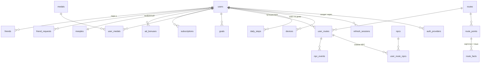

# Модель данных

Источник истины — миграции `backend/migrations/versions/`. Здесь — зачем каждая таблица и какие инварианты она держит. Все инварианты из раздела «Проверено тестами» покрыты `backend/tests/sql/test_steps_sync.sql`.

## Таблицы

### Из ТЗ (17)

| Таблица | Назначение | Ключевые решения |
|---|---|---|
| `users` | Профиль, настройки, права, счётчики | `friend_code` из 32 символов без 0/O/1/I; `premium_until` — кэш права; `timezone` проверяется триггером по `pg_timezone_names`; `lifetime_steps`, `streak_days`, `last_step_day` обновляет функция синка — сводка и медали не читают историю; `token_version` — мгновенный отзыв access JWT; `weight_kg` NULL, пока не введён |
| `auth_providers` | Способы входа | `UNIQUE(provider, provider_subject)`; токены провайдеров не храним |
| `routes` | Каталог маршрутов | `scope` city/intercity/world — межгородские маршруты без изменения схемы; `total_steps` — вычисляемая колонка при шаге 75 см; линия — в Object Storage, в БД только ключ, версия и хэш |
| `route_points` | Контрольные точки | `distance_m` от старта по линии; `card_type` city/surroundings/region; уникальны `seq`, `code`, `distance_m` в пределах маршрута |
| `route_facts` | Тексты карточек | Строка = точка × язык × порядковый номер; `draft` клиенту не отдаётся; опубликовать пустой шаблон запрещает CHECK |
| `user_routes` | Путешествия пользователя | Прогресс — `steps_done`; частичный уникальный индекс «один активный маршрут»; `group_id` — совместный маршрут |
| `daily_steps` | Шаги по локальным дням | Партиции по месяцам; PK `(user_id, day)`; `raw_steps` и `credited_steps` только растут |
| `goals` | Цели день/неделя/месяц | PK `(user_id, period)` |
| `npcs` | Справочник попутчиков | Базовый темп 2 000 / 4 000 / 6 000 м в день |
| `npc_events` | Сюжетные события попутчика в путешествии | `UNIQUE(user_route_id, npc_id, start_day)` — повторный расчёт не дублирует |
| `friends` | Дружба | Одна строка на пару, `CHECK (user_a < user_b)` — симметрия по построению |
| `friend_requests` | Заявки | Одна открытая заявка на пару в любую сторону (уникальный индекс по LEAST/GREATEST) |
| `medals` | Справочник медалей | `kind` + `threshold`; `is_premium_reward` — «доп. награды» подписки |
| `user_medals` | Выданные медали | `UNIQUE NULLS NOT DISTINCT (user_id, medal_id, user_route_id)`: вехи — на каждое прохождение, серии и дистанция — один раз. Удаление прохождения удаляет его медали каскадом |
| `subscriptions` | Подписки любого провайдера | `UNIQUE(provider, provider_subscription_id)`; `account_ref` сверяется с пользователем — чужую покупку не привязать; при удалении аккаунта обезличивается, а не удаляется; данные карт не хранятся никогда |
| `ad_bonuses` | Бонусы за ролики | PK `(user_id, id)`, id — UUID показа от клиента → повтор не начисляет дважды, чужой UUID не занять |
| `analytics_outbox` | Серверные события для AppMetrica | Отправка пачками; `next_attempt_at` с экспоненциальной паузой, после N попыток — `dead` |

### Служебные (11) — зачем добавлены

| Таблица | Почему без неё нельзя |
|---|---|
| `meeples` | Каталог миплов с флагом `is_free` — иначе замки пришлось бы хардкодить в приложении |
| `consents` | Какую версию политики ПДн и когда принял пользователь (152-ФЗ); история нужна как доказательство |
| `refresh_sessions` | Ротация refresh-токенов, отзыв цепочки при краже, абсолютный предел 180 дней |
| `auth_tokens` | Подтверждение email и сброс пароля — требование «восстановление через email» |
| `devices` | Push-токены RuStore; `install_id` генерирует приложение, аппаратные идентификаторы не собираем |
| `idempotency_keys` | Хранит ответ на запрос с `Idempotency-Key` 24 ч; ключ уникален в паре с пользователем |
| `user_route_npcs` | Снимок состояния NPC для ленивого детерминированного расчёта |
| `feed_events` | Лента друзей: старты, точки, вехи, финиши. Наружу — только дата и с задержкой 6 ч |
| `billing_events` | Дедупликация вебхуков провайдеров `UNIQUE(provider, event_id)` |
| `push_outbox` | Очередь пушей + журнал + дедупликация; на ней держатся «не чаще 2 в день» и тихие часы |
| `rate_limits` | Лимиты частоты (коды друзей, логины, регистрация) без Redis. UNLOGGED — после сбоя БД обнуляется, для лимитов это допустимо. На `/steps/days` не применяется |

## Правило блокировок

Любая транзакция, которая пишет данные пользователя (синк, бонус за ролик, старт маршрута, медали, лента), **начинается** с `SELECT … FROM users WHERE id = $1 FOR NO KEY UPDATE`. Именно NO KEY: обычный `FOR UPDATE` конфликтует с блокировкой KEY SHARE, которую внешний ключ берёт при вставке в дочернюю таблицу, и два запроса «бонус → синк» взаимно блокировались (воспроизведено ревью, закреплено тестом `concurrency`). Лимиты «сколько роликов сегодня» проверяются только после этой блокировки. Внутри такой транзакции — никаких внешних HTTP-вызовов.

## События — в той же транзакции и от абсолютного состояния

Медали, записи ленты и пуши создаются в той же транзакции, что и вызов `sync_daily_steps`, и вычисляются по текущему состоянию («`steps_done` ≥ 50 % → есть ли медаль „Полпути“ у этого прохождения»), а не по переходу «было → стало». Все вставки — `ON CONFLICT DO NOTHING` по уникальным ключам. Поэтому даже если что-то упало между шагами, следующий синк выдаст недостающее, а повтор не выдаст лишнего.

## Удаление аккаунта

* Мягкое (сразу): `token_version + 1` — все access JWT недействительны; refresh-сессии отозваны; дружбы и заявки удалены; `friend_code` заменён; из ленты пропадает. Email и способы входа сохраняются 30 дней — вход в этот срок восстанавливает аккаунт.
* Полное (через 30 дней, воркер `purge_deleted`): строка `users` удаляется, всё связанное — каскадом. Подписки остаются обезличенными (`user_id = NULL`, `ON DELETE SET NULL`) — финансовые записи хранятся по закону о бухучёте. Профиль в AppMetrica удаляется через её API.

## Шаги: правила зачёта

Функция `sync_daily_steps(user_id, days)`:

1. Блокирует строку пользователя (`FOR NO KEY UPDATE`, `lock_timeout` 3 с) → параллельные синки одного пользователя идут по очереди.
2. Если клиент прислал другой пояс — меняет `users.timezone` под той же блокировкой. «Сегодня» = дата по поясу на сервере. Принимаются дни от `сегодня − 30` до `сегодня + 1`. Уже открытый день сохраняет свой `tz`, сервер возвращает его клиенту, и клиент считает этот день строго в нём — иначе при перелёте вечерние часы попали бы в два дня.
3. Дубли дня внутри батча схлопываются максимумом. `raw = GREATEST(старое, новое)` — повтор и запоздавший батч безвредны. Два телефона не суммируются.
4. Разрешено к зачёту: премиум — всё; бесплатно — `min(raw, 2000 + бонусы дня)`.
5. `credited = GREATEST(старое credited, разрешённое)`, дельта уходит в активный маршрут, если день не раньше дня старта маршрута.
6. Маршрут не переполняется: при достижении `total_steps` статус `finished`.
7. Обновляет счётчики: `lifetime_steps` (по приросту raw), `last_step_day`, серию (день с ≥ 1 000 шагов; дозапись дня в прошлом пересчитывает серию в окне 400 дней).
8. `steps = null` у дня — «только пересчитать» (после бонуса за ролик): строку не создаёт, если её нет.
9. Возвращает JSON с днями, `tz` каждого дня, счётчиками и состоянием маршрута.

Почему так: сумма шагов не может «разъехаться» при сетевых повторах, а покупка подписки в течение дня честно засчитывает сегодняшние шаги сверх лимита.

**Ограничение, о котором надо помнить:** право (премиум/бесплатно) берётся на момент синка, а не на день шагов. Если бесплатный пользователь неделю был офлайн и купил подписку, при синке прошлые дни зачтутся без лимита. Это щедро к пользователю и редко — оставляем.

## Перевод шагов в метры и «осталось N дней»

* метры = шаги × 0,75; шаги маршрута = ⌈метры / 0,75⌉
* позиция мипла: `steps_done × 0,75` м вдоль ломаной; точка открыта, если её `distance_m` ≤ этого значения
* осталось дней = ⌈(total − done) / среднее зачтённое за 7 дней⌉, дни без шагов входят в среднее как 0; если среднее 0 — показываем «начни идти», а не бесконечность
* калории (оценка) = шаги × вес_кг × 0,0005 (≈ 350 ккал на 10 000 шагов при 70 кг)

## Партиции daily_steps

Миграция создаёт 24 месячные партиции с января 2026, у каждой `fillfactor = 80` (строка дня обновляется до ~12 раз в сутки — свободное место даёт обновления без раздувания индекса). Ежедневный воркер вызывает `ensure_daily_steps_partitions(3)` — всегда есть партиции на 3 месяца вперёд. Новая партиция создаётся отдельно и подключается через `ATTACH PARTITION`: так синки не останавливаются (прямой `CREATE … PARTITION OF` взял бы эксклюзивную блокировку на всю таблицу). При `lock_timeout` воркер просто повторит позже. Партиции по умолчанию (DEFAULT) нет сознательно: вставка вне диапазона должна падать громко, а не копиться в одной большой партиции.

## Проверено тестами

* 3 000 м → 4 000 шагов
* лимит 2 000 у бесплатного; повтор батча не меняет ни дня, ни маршрута; устаревший батч не уменьшает
* бонус за ролик поднимает зачёт того же дня до 3 000
* премиум снимает лимит, маршрут финиширует ровно на `total_steps`
* будущие, слишком старые и неправдоподобные дни отклоняются
* шаги до дня старта маршрута в маршрут не идут
* второй активный маршрут, код друга с «0», email в верхнем регистре, встречная заявка, неканоническая пара друзей — отклоняются
* медаль за серию — один раз, за веху — на прохождение
* в пользовательских таблицах нет ни одного гео-поля
* пересчёт несуществующего дня не создаёт строку и не роняет батч
* смена пояса применяется, открытый день сохраняет свой `tz`, несуществующий пояс отклоняется
* суммарные шаги и серия, включая дозапись пропущенного дня в прошлом; повтор не меняет сумму
* удаление прохождений с одинаковой вехой не падает, медали уходят каскадом
* маршрут 50 000 км не переполняет `total_steps`
* удаление пользователя обезличивает подписку
* новая партиция создаётся через ATTACH с `fillfactor = 80`
* 4 параллельные транзакции «бонус → синк» проходят без deadlock и дают ровно 6 000 зачтённых (тест ловит старую ошибку, проверено)
* миграции обратимы: upgrade → downgrade → upgrade
